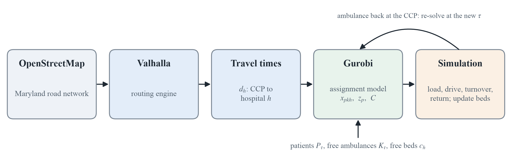

# Scope

We are building a dynamic mixed-integer optimization model that decides which ambulance carries which casualty to which hospital after a blast event at Oriole Park at Camden Yards in Baltimore. It is a decision-support and training tool for a slow-moving mass casualty incident (MCI) event and a virtual Emergency Medical Resource Center (EMRC) in which Maryland EMS planners and trainers can test resource decisions without staging a full-scale exercise. Casualties are tagged with START triage (red/immediate, yellow/delayed, green/minor, black/expectant) and appear over time. A limited ambulance fleet must make repeated trips to nearby hospitals whose trauma level and free capacity differ. The model re-plans in time slices as new casualties appear, patients deteriorate while they wait, hospital capacity fills, and roads near the stadium are restricted.

# Data

While our project works extensively with uncertainty, we use the following data to make educated assumptions. Road geometry and travel times come from [OpenStreetMap](https://www.openstreetmap.org/), with routes computed by the open-source [Valhalla](https://wiki.openstreetmap.org/wiki/Valhalla) routing engine. Branas, Sing & Perron [case series](https://pubmed.ncbi.nlm.nih.gov/11045407/) gives us real Maryland MCIs to anchor the casualty numbers, which we otherwise generate at random. The regulatory and operational setting comes from [COMAR 10.16.05.06A(6) Emergency Medical Services](https://regs.maryland.gov/us/md/exec/comar/10.16.05.06#A(6)) and from the [MIEMSS Emergency Medical Resource Center (EMRC)](https://www.miemss.org/home/departments/emrc), Maryland's statewide communications system linking ambulances, dispatch centers, hospital emergency departments and trauma centers, which gives the decision channels and stakeholders the model is meant to support. Hospital locations, capacity and trauma level come from the Homeland Infrastructure Foundation-Level Data ([HIFLD](https://portal.datarescueproject.org/datasets/hifld-open-hospitals/)) open hospitals layer, a Department of Homeland Security dataset.

# Methods

The solution has two optimization layers and a simulation that connects them (Figure 1).

* **Routing (Valhalla):** the open-source Valhalla routing engine computes driving times on the Maryland OpenStreetMap road network.
* **Assignment (Gurobi):** a mixed-integer program uses those travel times to decide which free ambulance takes which waiting patient to which hospital.
* **Simulation:** carries out each assignment (loading, driving, hospital turnover, return) and updates patients, beds and ambulances. The assignment model is then solved again at the next decision time.

At each decision time $\tau$ the assignment model assigns the ambulances that are free at the casualty collection point (CCP) to waiting patients and hospitals, at most one patient per ambulance. After an ambulance delivers its patient and returns to the CCP, the model is re-solved with the updated patients, hospital beds and ambulances.

{width=100%}

## Assignment Model (Gurobi)

### Sets and Parameters

| Symbol | Code | Meaning |
| :---------- | :---------------- | :------------------------------------------------ |
| $p\in P_\tau$ | P | Patients triaged, waiting and needing transport at decision time $\tau$ ($r_p\le\tau$) |
| $P_\tau^{c}$ | | Patients in $P_\tau$ with triage tag $c\in\{\text{RED},\text{YELLOW},\text{GREEN}\}$ |
| $k\in K_\tau$ | A | Ambulances free at the CCP at time $\tau$ |
| $h\in H_\tau$ | H | Hospitals with at least one free bed |
| $r_p$ | ready\_min | Readiness time of patient $p$ (time its triage is complete) |
| $\ell$ | loading\_minutes | Loading time at the CCP |
| $d_h$ | travel\_times\[h\] | Travel time from the CCP to hospital $h$ (from Valhalla) |
| $c_h$ | available\_beds\[h\] | Free beds at hospital $h$ |
| $g_{ph}\in\{0,1\}$ | compatible | 1 if hospital $h$ may receive patient $p$'s triage tag |
| $\tau$ | current\_time | Current decision time (minutes since start) |

### Decision Variables

| Variable | Type | Meaning |
| :---------- | :---------------- | :------------------------------------------------ |
| $x_{pkh}$ | Binary | 1 if ambulance $k$ takes patient $p$ to hospital $h$ in this batch |
| $z_p$ | Binary | 1 if patient $p$ is assigned in this batch |
| $C$ | Continuous, $\geq 0$ | Makespan: latest hospital arrival in this batch |

### Objective

Lexicographic (Gurobi multi-objective), with priorities $(4) > (1) > (2) > (3)$:
$$
\begin{aligned}
&(1)\quad \max \sum_{p\in P_\tau^{\text{RED}}} z_p &\qquad\qquad& (2)\quad \max \sum_{p\in P_\tau^{\text{YELLOW}}} z_p \\[2pt]
&(3)\quad \max \sum_{p\in P_\tau^{\text{GREEN}}} z_p && (4)\quad \min\ C
\end{aligned}
$$

### Constraints

**C1. Each patient is transported at most once.** $z_p$ records whether patient $p$ is transported, so the lexicographic objective can leave a patient unserved when beds or ambulances run out.
$$\sum_{k\in K_\tau}\sum_{h\in H_\tau} x_{pkh} = z_p \qquad \forall\, p\in P_\tau$$

**C2. Each ambulance carries at most one patient.**
$$\sum_{p\in P_\tau}\sum_{h\in H_\tau} x_{pkh} \le 1 \qquad \forall\, k\in K_\tau$$

**C3. Hospital bed capacity.**
$$\sum_{p\in P_\tau}\sum_{k\in K_\tau} x_{pkh} \le c_h \qquad \forall\, h\in H_\tau$$

**C4. Hospital compatibility.** A hospital with no route from the CCP is also excluded ($x_{pkh}=0$).
$$x_{pkh} \le g_{ph} \qquad \forall\, p\in P_\tau,\ k\in K_\tau,\ h\in H_\tau$$

**C5. Makespan.** A patient sent to hospital $h$ at decision time $\tau$ arrives at $\tau+\ell+d_h$. $C$ cannot be earlier than any of these arrivals, so it equals the latest hospital arrival in this batch.
$$C \ge \left(\tau + \ell + d_h\right) x_{pkh} \qquad \forall\, p\in P_\tau,\ k\in K_\tau,\ h\in H_\tau$$

**Variable domains.** $x_{pkh},\ z_p \in \{0,1\}$ and $C\ge 0$.

# Expected Outcome

The model outputs the total time to clear the scenario and the expected number of patients successfully transported, allowing EMS to assess what a given set of resources can achieve and where additional capacity would save more lives.

# Analysis

As we develop the solver:

* **Baseline comparison:** We will then compare the optimized solution with simple response policies.
* **Scenario analysis:** We will retrieve documented MCI scenarios and use their casualty numbers, triage distributions, resource availability, and operational conditions to construct realistic test cases. Baltimore will remain the primary setting. If time permits, we will apply the model to a documented incident in another city to test whether the approach transfers to a different hospital and transportation network.

If the baseline solver performs well,

* **Dynamic analysis:** test the model using rolling-horizon reoptimization. Patient counts and conditions will change as new casualties appear or deteriorate, while ambulance status will change as vehicles become available or experience delays.
* **Leadership and resource-escalation analysis:** Identify when incident command should request or pre-position additional ambulances, hospital capacity, or mutual-aid resources, and measure their effects on priority-patient waiting and incident clearance times.
* **Robustness and stress testing:** Test recommendations under changing casualty counts, hospital and ambulance availability, major road or bridge closures, and emergency-only road access. Measure patient throughput and waiting time, incident clearance time, resource utilization, unserved patients, solver runtime, and optimality gap.

# Timeline

| Milestone | Status at that point |
| :------------ | :------------------------------------------------------------------ |
| End of week 1 | The formulation matches the code; main holds all features. |
| End of week 2 | The baseline resource set is frozen; the optimizer will be tested against different patient scenarios. |
| End of week 3 | Baseline resources may be modified for differing scenarios, all experiments done; Results section drafted. |
| Week 4 | Writing and validation only, no new modelling. |

# References

Repoussis, P.P., Paraskevopoulos, D.C., Vazacopoulos, A. and Hupert, N. (2016). 'Optimizing emergency preparedness and resource utilization in mass-casualty incidents', *European Journal of Operational Research*, 255, pp. 531–544. doi:10.1016/j.ejor.2016.05.047.
