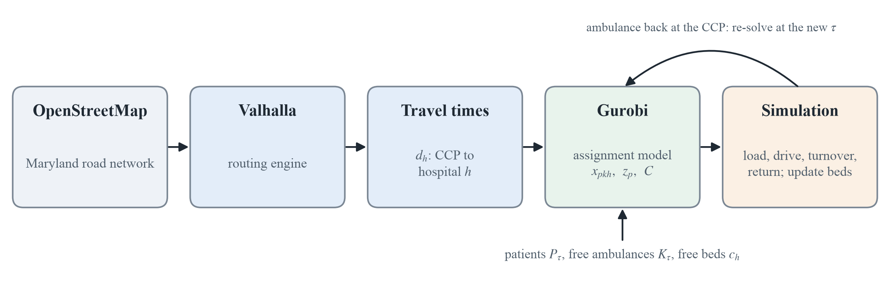
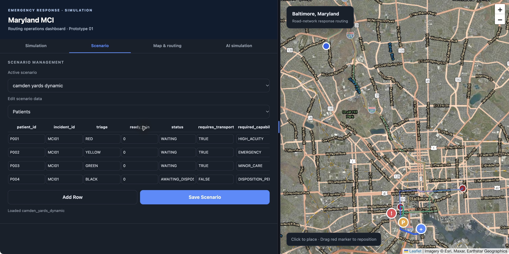
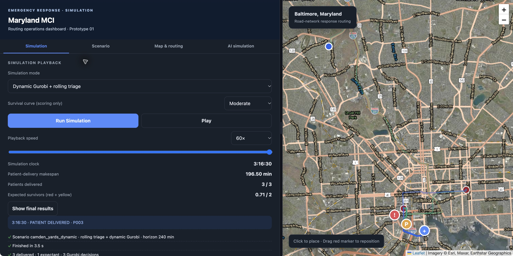
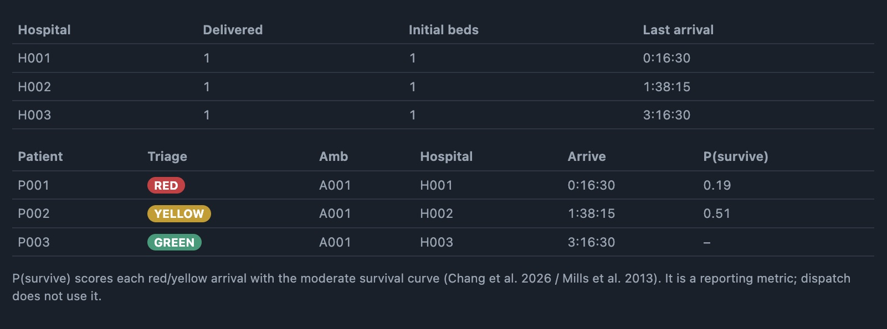

## The response problem

::: {.lead}
Which ambulance takes which casualty to which hospital?
:::

- **Setting:** a blast event at Oriole Park at Camden Yards in Baltimore.
- **Resources:** a limited ambulance fleet and hospitals with different trauma capabilities and free capacity.
- **Purpose:** a virtual Emergency Medical Resource Center (EMRC) for planning and training.

::: {.notes}
We focus on a slow-moving mass casualty incident. The aim is to help Maryland EMS planners test resource decisions without staging a full-scale exercise. Our report proposes a dynamic mixed-integer optimization model for this setting.
:::

## An incident that changes over time

::: {.columns}
::: {.column width="53%"}
### START triage

| Tag | Category |
|:--|:--|
| **RED** | Immediate |
| **YELLOW** | Delayed |
| **GREEN** | Minor |
| **BLACK** | Expectant |
:::
::: {.column width="43%"}
### Changing conditions

- New casualties appear and complete triage.
- Waiting patients may deteriorate.
- Ambulances return for repeated trips.
- Hospital capacity fills and roads may be restricted.
:::
:::

::: {.notes}
At each decision time, the model uses the current patient set and resource state. The assignment formulation shown next covers red, yellow and green patients who are ready and waiting for transport. Black patients are outside this transport assignment set.
:::

## Data and assumptions

| Input | Source or treatment |
|:--|:--|
| Road network and driving times | OpenStreetMap, routed with Valhalla |
| Casualty numbers | Random generation anchored to Maryland MCI evidence |
| Hospital locations and attributes | HIFLD Open Hospitals layer |
| Operational setting | MIEMSS EMRC and Maryland EMS regulations |

::: {.small}
Casualty demand and available resources remain scenario inputs. Experiments will test how results change when those inputs vary.
:::

::: {.notes}
Sources from the midterm report: OpenStreetMap, https://www.openstreetmap.org/; Valhalla, https://wiki.openstreetmap.org/wiki/Valhalla; Branas, Sing and Perron case series, https://pubmed.ncbi.nlm.nih.gov/11045407/; HIFLD archive, https://portal.datarescueproject.org/datasets/hifld-open-hospitals/; MIEMSS EMRC, https://www.miemss.org/home/departments/emrc; COMAR, https://regs.maryland.gov/us/md/exec/comar/10.16.05.06. We use the regulation as context here and make no claim that it governs Camden Yards. Licensed hospital beds do not establish live MCI intake capacity. Capacity supplied to the model is a scenario assumption.
:::

## Routing, assignment and simulation

{width=100% fig-alt="OpenStreetMap supplies the road network, Valhalla computes hospital travel times, Gurobi assigns patients and ambulances, and simulation updates the state before reoptimization."}

::: {.small}
**Valhalla** supplies travel times. **Gurobi** chooses assignments. The **simulation** executes trips and updates the next decision state.
:::

::: {.notes}
This figure comes directly from the midterm report. Routing and patient assignment are separate tasks. The simulation handles loading, driving, hospital turnover and the return to the casualty collection point, or CCP.
:::

## Travel times from Valhalla {.code-slide}

::: {.columns}
::: {.column width="42%"}
### Road network routing

The simulation requests a driving route between two coordinates.

Valhalla returns travel time in seconds. The simulator converts it to minutes for the assignment model.
:::
::: {.column width="54%"}
```python
response = requests.post(
    f"{VALHALLA_URL}/route",
    json=payload,
    timeout=60
)

response.raise_for_status()

result = response.json()
summary = result["trip"]["summary"]
```
:::
:::

::: {.source-label}
Source: `dynamic_mci/simulation/engine.py` · `get_route()`
:::

::: {.notes}
Exact excerpt from get_route. The payload above this excerpt contains the origin and destination coordinates and auto costing. The function later returns summary["time"] / 60.0 as travel_minutes. The routing service supplies travel times rather than choosing patients or allocating beds.
:::

## The assignment model at time $\tau$

::: {.columns}
::: {.column width="48%"}
### Eligible sets

| Set | Meaning |
|:--|:--|
| $P_\tau$ | Triaged patients waiting for transport |
| $K_\tau$ | Ambulances free at the CCP |
| $H_\tau$ | Hospitals with free beds |
:::
::: {.column width="48%"}
### Inputs

| Symbol | Meaning |
|:--|:--|
| $\ell$ | Loading time |
| $d_h$ | Travel time to hospital $h$ |
| $c_h$ | Available beds at hospital $h$ |
| $g_{ph}$ | Patient–hospital compatibility |
:::
:::

::: {.small}
Patient $p$ enters the eligible set after triage is complete: $r_p\le\tau$.
:::

## Decision variables in Gurobi {.code-slide}

::: {.columns}
::: {.column width="42%"}
| Variable | Meaning |
|:--|:--|
| $x_{pkh}$ | Patient–ambulance–hospital assignment |
| $z_p$ | Patient receives an assignment |
| $C$ | Latest arrival in the batch |

The code uses `a` for the ambulance index and `makespan` for $C$.
:::
::: {.column width="54%"}
```python
x = model.addVars(
    P, A, H,
    vtype=GRB.BINARY,
    name="assignment"
)
z = model.addVars(
    P,
    vtype=GRB.BINARY,
    name="assigned"
)
makespan = model.addVar(
    lb=0,
    vtype=GRB.CONTINUOUS,
    name="makespan"
)
```
:::
:::

::: {.source-label}
Source: `dynamic_mci/optimization/optimizer/mci_ambulance_gurobi.py` · `optimize_mci()`
:::

::: {.notes}
Source excerpt with comments and blank lines omitted. All variables and model calls are unchanged. A patient can remain unassigned when no feasible resource combination is available.
:::

## Objective priorities

The assignment model uses a lexicographic objective.

| Order | Objective |
|:--|:--|
| 1 | Maximize RED assignments: $\max\sum_{p\in P_\tau^{\mathrm{RED}}}z_p$ |
| 2 | Maximize YELLOW assignments: $\max\sum_{p\in P_\tau^{\mathrm{YELLOW}}}z_p$ |
| 3 | Maximize GREEN assignments: $\max\sum_{p\in P_\tau^{\mathrm{GREEN}}}z_p$ |
| 4 | Minimize the latest arrival: $\min C$ |

::: {.small}
Each lower objective preserves the best value of the higher objectives.
:::

::: {.notes}
This slide follows the batch optimizer in dynamic_mci/optimization/optimizer/mci_ambulance_gurobi.py: RED priority 4, YELLOW 3, GREEN 2 and makespan 1. The source report's ordering statement, (4) > (1) > (2) > (3), conflicts with that implementation. Putting makespan first in this formulation would allow an empty assignment batch with C = 0. This correction applies only to this slide deck. The separate dynamic single-dispatch optimizer has its own hierarchy and is outside this report's batch formulation.
:::

## Objective priorities in Gurobi {.code-slide}

::: {.columns}
::: {.column width="42%"}
### `setObjectiveN()`

The preceding loop sets:

- RED: priority **4**
- YELLOW: priority **3**
- GREEN: priority **2**

`weight=-1` maximizes assignments under the model's default minimization sense. Makespan has priority **1**.
:::
::: {.column width="54%"}
```python
model.setObjectiveN(
        gp.quicksum(z[p] for p in group),
        index=4-priority,
        priority=priority,
        weight=-1,
        name=f"assign_{triage}"
    )

model.setObjectiveN(
    makespan,
    index=3,
    priority=1,
    weight=1,
    name="minimize_makespan"
)
```
:::
:::

::: {.source-label}
Source: `dynamic_mci/optimization/optimizer/mci_ambulance_gurobi.py` · excerpt from `optimize_mci()`
:::

::: {.notes}
The first setObjectiveN call sits inside the loop over triage groups. The second sits outside the loop. Larger priority values take precedence. This batch model differs from the dynamic single-dispatch model shown in the dashboard demonstration.
:::

## Feasible assignments

::: {.columns}
::: {.column width="48%"}
### Resource limits

- Each patient receives at most one assignment.
- Each free ambulance carries at most one patient in the batch.
- Assignments cannot exceed hospital bed capacity.
:::
::: {.column width="48%"}
### Hospital and timing limits

- Each destination must be compatible with the patient's triage tag.
- Unreachable hospitals are excluded.
- Arrival includes the current time, loading and travel.
:::
:::

$$C\geq(\tau+\ell+d_h)x_{pkh}$$

::: {.notes}
Full constraints appear in the appendix. Capacity is enforced across all patients and ambulances assigned to a hospital in the batch. Travel times come from the external router.
:::

## Assignment constraints in code {.code-slide}

::: {.columns}
::: {.column width="42%"}
### Patient assignment

$$\sum_{k,h}x_{pkh}=z_p$$

A binary $z_p$ permits at most one assignment.

### Ambulance capacity

$$\sum_{p,h}x_{pkh}\leq1$$

One patient per ambulance in each batch.
:::
::: {.column width="54%"}
```python
for p in P:
    model.addConstr(
        gp.quicksum(
            x[p, a, h]
            for a in A for h in H
        ) == z[p]
    )

for a in A:
    model.addConstr(
        gp.quicksum(
            x[p, a, h]
            for p in P for h in H
        ) <= 1
    )
```
:::
:::

::: {.source-label}
Source: `dynamic_mci/optimization/optimizer/mci_ambulance_gurobi.py` · `optimize_mci()`
:::

## Reoptimization during the response

1. Observe waiting patients, free ambulances and available beds.
2. Solve the current assignment batch.
3. Execute loading, transport, hospital turnover and return.
4. Update the state and solve again when an ambulance is available.

::: {.small}
The simulation connects repeated assignment decisions over the incident.
:::

::: {.notes}
This is the report's proposed dynamic workflow. A batch assignment optimum does not establish that the complete sequence of future trips is globally optimal. Dynamic analysis remains part of the planned evaluation in the midterm report.
:::

## Current dashboard implementation

| Report's batch model | Dashboard's dynamic mode |
|:--|:--|
| Assigns all currently free ambulances in a batch | Selects one patient and hospital when the ambulance is free |
| RED, YELLOW, GREEN counts, then makespan | Observed triage priority, waiting time, travel time, tie-breaking |
| Repeated batches connect through simulation | Rolling triage, reassessment, stabilization and bed reservations |

::: {.small}
The current dynamic scheduler requires one ambulance. The following screenshots show a synthetic demonstration of that implementation.
:::

::: {.notes}
The static endpoint calls simulation.engine.run_simulation, which calls the batch optimizer. The dynamic endpoint calls triage_engine.run_triage followed by integrated_scheduler.run. That scheduler calls gurobi_dispatch.choose_dispatch. The latter optimizes a single dispatch at a time and does not claim a globally optimal multi-trip response. Clinical deterioration is synthetic.
:::

## Dashboard: scenario inputs {.dashboard-slide}

{width=100% fig-alt="MCP screenshot of the scenario editor showing four synthetic patients with red, yellow, green and black triage tags alongside the Baltimore map."}

::: {.small}
`camden_yards_dynamic`: four synthetic patients, including one BLACK patient who does not require transport.
:::

::: {.notes}
Captured through MCP from the running local dashboard at http://127.0.0.1:8000/. Scenario inputs were viewed without saving changes. Browser chrome is cropped out. Map attribution remains visible in the original capture and this image: Esri, Maxar and Earthstar Geographics. Screenshot capture on November 11, 2026, America/New_York.
:::

## Dashboard: simulation playback {.dashboard-slide}

{width=100% fig-alt="MCP screenshot showing dynamic simulation playback, a final delivery time of 196.50 minutes, three delivered patients and ambulance routes on the Baltimore map."}

::: {.small}
One ambulance, three Gurobi dispatch decisions, and a last delivery at **196.5 minutes**.
:::

::: {.notes}
Observed run: integrated_20261112_020012_d5fd5e6c. The run ID uses UTC; the capture took place on November 11 in America/New_York. This is a small synthetic demonstration, not a comparison with a baseline policy. The screenshot displays survival scoring, which does not affect the dynamic dispatch objective. Its expected-survivor score is a model output, not an observed clinical outcome. Map imagery attribution: Esri, Maxar and Earthstar Geographics.
:::

## Dashboard: patient and hospital results {.dashboard-results}

{width=100% fig-alt="MCP screenshot of hospital and patient result tables: P001 RED reaches H001 at 16.5 minutes, P002 YELLOW reaches H002 at 98.25 minutes, and P003 GREEN reaches H003 at 196.5 minutes."}

::: {.small}
**3 delivered, 1 expectant.** Each receiving hospital uses its one available bed in this example. Survival scores are reporting metrics only.
:::

::: {.notes}
The same run records three delivered patients and one expectant patient. Expectant does not establish death. H001 is R Adams Cowley Shock Trauma Center, H002 Johns Hopkins Hospital and H003 Sinai Hospital of Baltimore. These are scenario capacities, not verified live hospital availability. The screenshot is a crop of the visible dashboard results panel.
:::

## Planned evaluation

| Comparison | Question |
|:--|:--|
| Simple response policies | How much does optimization improve the response? |
| Documented MCI scenarios | How do different casualty counts and triage mixes affect performance? |
| Dynamic scenarios | What changes as patients deteriorate and vehicles become available? |
| Resource and road stress tests | Where do extra ambulances or beds help most? |

::: {.small}
Baltimore remains the primary setting. Transfer to another city is an extension if time permits.
:::

::: {.notes}
These are planned analyses, not completed experimental findings. Scenario construction will use documented casualty counts, resource availability and operational conditions where available. Leadership analysis will consider when to request or pre-position additional resources.
:::

## Expected outputs

### Response performance

Patient throughput and waiting time, incident clearance time, resource utilization and unserved patients.

### Solver performance

Runtime and optimality gap.

::: {.lead}
The planning question: what can the available resources achieve, and where would added capacity help?
:::

::: {.notes}
The report expects the tool to output total clearance time and the number successfully transported. These measures support resource planning. Transport counts alone do not establish lives saved or clinical survival, and the midterm report presents no experimental results yet.
:::

## Project timeline

| Milestone | Planned status |
|:--|:--|
| End of week 1 | Align formulation and code, consolidate features on main |
| End of week 2 | Freeze baseline resources and test patient scenarios |
| End of week 3 | Complete experiments and draft Results |
| Week 4 | Writing and validation, with no new modelling |

::: {.notes}
These milestones reproduce the timeline in the midterm report. They describe planned status at each point rather than a verification of current completion.
:::

## Appendix: assignment and capacity {.appendix}

**C1. Patient assignment**

$$\sum_{k\in K_\tau}\sum_{h\in H_\tau}x_{pkh}=z_p\qquad\forall p\in P_\tau$$

**C2. Ambulance capacity**

$$\sum_{p\in P_\tau}\sum_{h\in H_\tau}x_{pkh}\leq1\qquad\forall k\in K_\tau$$

**C3. Hospital capacity**

$$\sum_{p\in P_\tau}\sum_{k\in K_\tau}x_{pkh}\leq c_h\qquad\forall h\in H_\tau$$

## Appendix: compatibility and arrival {.appendix}

**C4. Hospital compatibility**

$$x_{pkh}\leq g_{ph}\qquad\forall p\in P_\tau,k\in K_\tau,h\in H_\tau$$

**C5. Latest arrival in the batch**

$$C\geq(\tau+\ell+d_h)x_{pkh}\qquad\forall p\in P_\tau,k\in K_\tau,h\in H_\tau$$

**Variable domains**

$$x_{pkh},z_p\in\{0,1\},\qquad C\geq0$$

::: {.small}
Set $x_{pkh}=0$ when hospital $h$ has no route from the CCP.
:::

## Appendix: sources {.references}

- Repoussis, P. P., Paraskevopoulos, D. C., Vazacopoulos, A. & Hupert, N. (2016). Optimizing emergency preparedness and resource utilization in mass-casualty incidents. *European Journal of Operational Research*, 255, 531–544. [doi:10.1016/j.ejor.2016.05.047](https://doi.org/10.1016/j.ejor.2016.05.047)
- Branas, Sing & Perron. [Maryland MCI case series](https://pubmed.ncbi.nlm.nih.gov/11045407/)
- [OpenStreetMap](https://www.openstreetmap.org/) and [Valhalla](https://wiki.openstreetmap.org/wiki/Valhalla)
- [HIFLD Open Hospitals archive](https://portal.datarescueproject.org/datasets/hifld-open-hospitals/)
- [MIEMSS Emergency Medical Resource Center](https://www.miemss.org/home/departments/emrc) and [COMAR 10.16.05.06](https://regs.maryland.gov/us/md/exec/comar/10.16.05.06)
